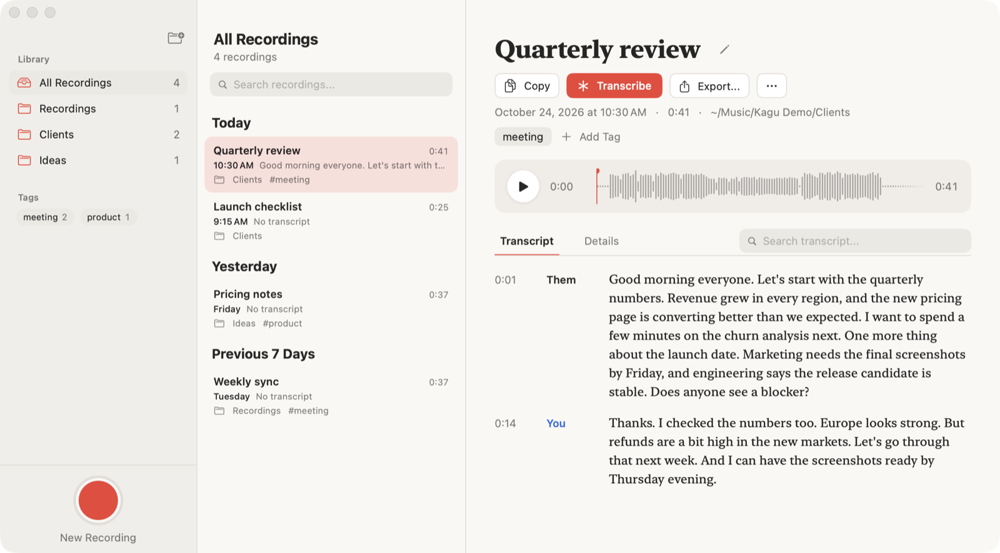

# Kagu

One record button for your Mac. Kagu records your microphone and everything the Mac plays (Meet, Discord, a video) into one file, then writes a transcript on this Mac with **You** and **Them** kept apart. What you hear does not change.

<picture>
  <source media="(prefers-color-scheme: dark)" srcset="docs/screenshot-dark.png">
  
</picture>

## Install

```sh
gh release download -R us/kagu -p Kagu.dmg -D /tmp --clobber && hdiutil attach -nobrowse -quiet /tmp/Kagu.dmg && ditto /Volumes/Kagu/Kagu.app /Applications/Kagu.app && hdiutil detach -quiet /Volumes/Kagu && open /Applications/Kagu.app
```

Needs macOS 15. Build from source: `./build.sh`. Everything else: [docs/leaflet.md](docs/leaflet.md).
